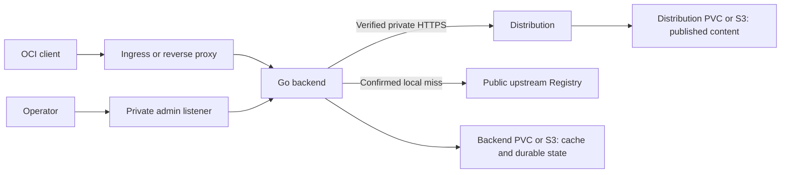

# Architecture

Registry Hub provides one OCI Distribution endpoint for local publication and upstream mirror reads. The Go backend controls access and routing; a separate CNCF Distribution process stores published content.

## Component boundaries

The chart deploys separate backend and Distribution Pods, with one instance of each. Only the backend exposes a client ingress. Distribution uses a private authenticated HTTPS Service protected by NetworkPolicy. The admin listener has a separate Service and credentials.

Backend storage and Distribution storage are independent:

| Storage domain | Contents | Default |
| --- | --- | --- |
| Backend | Verified temporary objects, task state, inventory, durable background work, checkpoints, leases, deletion generations, repair state, and GC gate state. | 20 GiB filesystem PVC. |
| Distribution | Published images and other OCI artifacts. | 100 GiB filesystem PVC. |

Each can use its own S3 configuration. The backend reads and writes published content through the standard Registry API; it does not manipulate Distribution's private storage layout.

## Reads and publication

1. Parse the logical repository and query internal Distribution.
2. Return a local hit. Authentication failures, storage failures, and internal server errors are treated as errors.
3. On a confirmed miss, use the first repository component as the upstream authority when the name contains a slash. A single-component name remains local.
4. Fetch upstream content using separate credentials and transport rules, then verify digest, size, and structure before use.
5. Persist manifest discovery and blob intent separately. Background work may fetch missing manifest metadata, but it does not fetch missing blob payloads; payloads must come from a complete verified cache entry or already exist in Distribution.
6. Transfer ready blobs independently, verify them through Distribution readback, and make duplicate cache data eligible for protected cleanup. Publish a ready platform manifest by digest without waiting for unrelated platforms.
7. Publish parent indexes and the requested root reference only after the original root's complete closure is locally available and verified.

The client pull can finish before background transfer or publication. A platform can become available independently, while the root reference waits for every referenced platform. Registry Hub preserves artifact bytes, media types, and digests; it does not render charts or interpret signatures and SBOMs.

Internal readiness checks use complete markers, verified cache metadata, size, and the current object identity. Readiness identifies a candidate; it does not establish Distribution presence. Client reads and Distribution uploads still verify the entire cached payload before exposing bytes. Unknown or legacy cache identities enter durable `cache_verification` work using the existing shared payload capacity, rather than hashing inside a short scheduling quantum. Destructive download cleanup independently verifies the committed cache version once per bounded attempt and retains its renewable reader pin and object lease. Each batch checks current cache identity, session/version, recovery/deletion state, and ownership fences; progress is checkpointed under the running queue claim. A new attempt always verifies again before removing current resumable input.

Cache expiry and orphan cleanup also use shared payload capacity and the configured download-finalization budget because conditional filesystem deletion hashes content. A known payload version goes directly to conditional deletion; unknown-version corruption cleanup still reads the current version first. Reader protection, recovery barriers, renewable source leases, and per-object conditional deletion remain authoritative.

Strict filesystem cache reads open one regular-file descriptor, verify digest, size, the existing SHA-256 storage version, and descriptor stability, then rewind that same handle. Verification reads one payload; verification plus full consumption reads two. Reader pins cover verification and consumption, and long hashing does not retain the striped cache identity lock. General filesystem object versions and conditional operations continue to use content hashes. S3 uses a verified first GET and a conditional consumption GET bound to the same ETag and size; the artifact digest remains mandatory.

The observation and recovery wrappers both forward optimized payload opens and conditional reads to the storage backend. Capability regressions exercise the complete production wrapper chain; the recovery mutation barrier remains enforced independently of reads. Backends without these optional capabilities retain the verified generic fallback.

Filesystem mutations retain a per-object file lock through conditional checks and durable commit. Active staging files are registered for orphan cleanup; payload copying holds no store-wide mutex. This permits unrelated lease and metadata writes during a large upload while preserving same-object serialization and staging retention.

Completed manifest discovery can be reused within its exact task round, root/content generations, and parser/limit compatibility. An additive snapshot records validated immutable edges and reverse parent relationships. Dependency changes durably identify affected manifests and ancestors; missing hints, incomplete or incompatible state, retries, and changed GC epochs retain full processing as a fallback. Reuse still checks deletion generations and repairs cache protection references. GC epochs and task leases are checked before protected publication; a reused graph never supplies a new proof of Distribution presence.

Task workers share a dispatch scan over durable ready candidates and due retries, stopping when worker capacity is full. The task record remains authoritative; updates that cannot immediately publish an index entry are replayed by bounded reconciliation. A cold upgrade or missing entry may require a history scan before its candidate is rebuilt. The processor rechecks current task state, recovery, retry timing, and ownership under its lease; quota FIFO and admission capacity remain independent constraints.

Ordinary Distribution blob verification shares a renewable object lease and a durable observation qualified by object identity, content generation, and GC epoch. A caller without the lease queues bounded payload work and yields; an upload worker holding the lease may verify inline. Completion wakes the source task, and reconciliation recovers a missing or completed handoff without repeatedly waking a live verification. Each task retains its own protection and publication checks.

Blob intents retain a notification acknowledgement alongside their state. Verified cache commits send bounded activation hints; durable intents and periodic source scans recover lost hints. Readiness and completion enqueue paged notifications, with independent durable work for each dependent root. An acknowledgement is saved only after the corresponding wakes are persisted. Conditional writes and demand revisions prevent old acknowledgements from replacing newer state. Periodic demand scans also recover targets added during notification processing. Notification replay does not extend the idle deadline.

Inventory projection and committed-download cleanup have separate durable queues and retry state. Authoritative discovery and execution facts precede successful responses or actual solidification. Derived inventory associations and download residue cleanup follow asynchronously. Outstanding download residue retains its quota until safe cleanup finishes. Health probes run independently of paged statistics and maintenance. See [Inventory](inventory.md#background-work-management) for status, recovery, and operator retry interfaces.

Capacity waits retain their durable FIFO position after wakeup while pending or running. Younger scopes cannot take admission ahead of that request until its admission attempt finishes or it safely leaves the quota queue.

Logical paths such as `docker.io/library/busybox` stay visible to clients. Internal name encoding accommodates Distribution's repository grammar and is removed from client-visible responses. `docker.io` has a built-in transport profile for the official Docker Hub endpoint.

## Writes and deletion

Push, upload, tag, and delete operations always target local Distribution, even for an upstream-prefixed path. The first verified publication of a tag wins; a different digest conflicts. Deletion generations prevent old background work from republishing deleted content.

Referrer reads use native support or an OCI fallback index. Durable repair state supports interrupted updates and verified fallback-to-native migration. Deleting a subject does not cascade to referrer content.

## GC and recovery

GC first drains accepted writes, then closes the backend write gate. It is refused while solidification protection sessions or unresolved recovery state remain. It runs official Distribution GC only with exclusive writer confirmation and background Distribution upload purging disabled. Reads may continue when Distribution remains available.

The gate and executor identity are persistent. Failure or uncertainty keeps writes blocked after restart until a protected recovery operation confirms a safe state. Tasks and object coordination also use persistent state so interrupted work can resume.

Interrupted remote writes recover through verified presence or confirmed repository absence. Absence permits a retry after recovery completes; it never marks content solidified or releases the session or reservation. The session conservatively retains possible unanchored content and continues to block GC. Unknown responses, missing write identity, and corrupt payloads retain the recovery barrier. Remote absence and verified payload are separate durable checkpoint states.

The supported topology is a single backend and a single Distribution instance. Active-active operation and automatic storage migration are outside the current deployment model. See [Configuration](configuration.md), [Security](security.md), and [Operations](operations.md) for deployment and lifecycle details.
