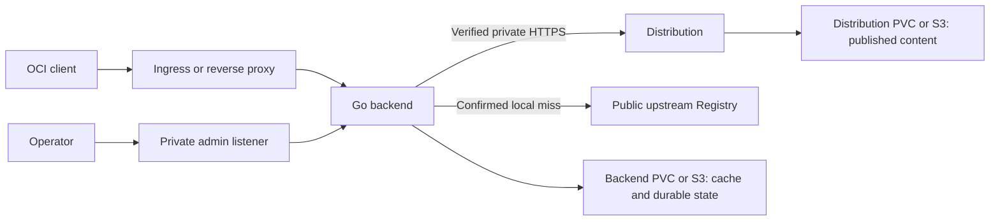

# Architecture

Registry Hub provides one OCI Distribution endpoint for local publication and upstream mirror reads. The Go backend controls access and routing; a separate CNCF Distribution process stores published content.

## Component boundaries

The chart deploys separate backend and Distribution Pods, with one instance of each. Only the backend exposes a client ingress. Distribution uses a private authenticated HTTPS Service protected by NetworkPolicy. The admin listener has a separate Service and credentials.

Backend storage and Distribution storage are independent:

| Storage domain | Contents | Default |
| --- | --- | --- |
| Backend | Verified temporary objects, task state, inventory, durable background work, checkpoints, leases, deletion generations, repair state, and GC gate state. | 20 GiB filesystem PVC. |
| Distribution | Published images and other OCI artifacts. | 100 GiB filesystem PVC. |

Each can use its own S3 configuration. The backend reads and writes published content through the standard Registry API; it does not manipulate Distribution's private storage layout.

## Reads and publication

1. Parse the logical repository and query internal Distribution.
2. Return a local hit. Authentication failures, storage failures, and internal server errors are treated as errors.
3. On a confirmed miss, use the first repository component as the upstream authority when the name contains a slash. A single-component name remains local.
4. Fetch upstream content using separate credentials and transport rules, then verify digest, size, and structure before use.
5. Persist manifest discovery and blob intent separately. Background work may fetch missing manifest metadata, but it does not fetch missing blob payloads; payloads must come from a complete verified cache entry or already exist in Distribution.
6. Transfer ready blobs independently, verify them through Distribution readback, and make duplicate cache data eligible for protected cleanup. Publish a ready platform manifest by digest without waiting for unrelated platforms.
7. Publish parent indexes and the requested root reference only after the original root's complete closure is locally available and verified.

The client pull can finish before background transfer or publication. A platform can become available independently, while the root reference waits for every referenced platform. Registry Hub preserves artifact bytes, media types, and digests; it does not render charts or interpret signatures and SBOMs.

Blob intents retain a notification acknowledgement alongside their state. Verified cache commits send bounded activation hints; durable intents and periodic source scans recover lost hints. Readiness and completion enqueue paged notifications, with independent durable work for each dependent root. An acknowledgement is saved only after the corresponding wakes are persisted. Conditional writes and demand revisions prevent old acknowledgements from replacing newer state. Periodic demand scans also recover targets added during notification processing. Notification replay does not extend the idle deadline.

Inventory projection and committed-download cleanup have separate durable queues and retry state. Authoritative discovery and execution facts precede successful responses or actual solidification. Derived inventory associations and download residue cleanup follow asynchronously. Outstanding download residue retains its quota until safe cleanup finishes. Health probes run independently of paged statistics and maintenance. See [Inventory](inventory.md#background-work-management) for status, recovery, and operator retry interfaces.

Capacity waits retain their durable FIFO position after wakeup while pending or running. Younger scopes cannot take admission ahead of that request until its admission attempt finishes or it safely leaves the quota queue.

Logical paths such as `docker.io/library/busybox` stay visible to clients. Internal name encoding accommodates Distribution's repository grammar and is removed from client-visible responses. `docker.io` has a built-in transport profile for the official Docker Hub endpoint.

## Writes and deletion

Push, upload, tag, and delete operations always target local Distribution, even for an upstream-prefixed path. The first verified publication of a tag wins; a different digest conflicts. Deletion generations prevent old background work from republishing deleted content.

Referrer reads use native support or an OCI fallback index. Durable repair state supports interrupted updates and verified fallback-to-native migration. Deleting a subject does not cascade to referrer content.

## GC and recovery

GC first drains accepted writes, then closes the backend write gate. It is refused while solidification protection sessions or unresolved recovery state remain. It runs official Distribution GC only with exclusive writer confirmation and background Distribution upload purging disabled. Reads may continue when Distribution remains available.

The gate and executor identity are persistent. Failure or uncertainty keeps writes blocked after restart until a protected recovery operation confirms a safe state. Tasks and object coordination also use persistent state so interrupted work can resume.

The supported topology is a single backend and a single Distribution instance. Active-active operation and automatic storage migration are outside the current deployment model. See [Configuration](configuration.md), [Security](security.md), and [Operations](operations.md) for deployment and lifecycle details.
